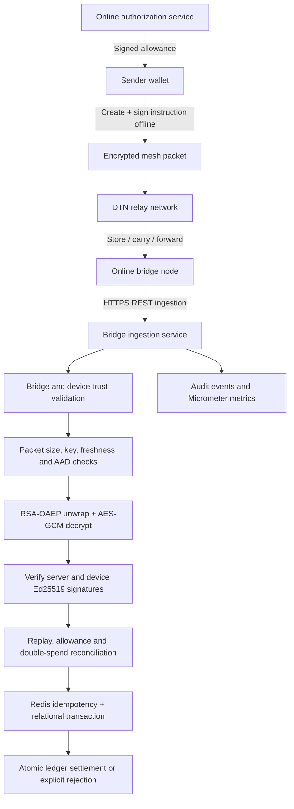

# Offline Payment Mesh

<p align="center">
  <strong>A pre-funded, cryptographically authenticated offline payment protocol over Delay-Tolerant Networks</strong>
  <br />
  <em>Research prototype and backend simulator for resilient digital payments during intermittent or absent connectivity.</em>
</p>

<p align="center">
  
  
  
  
  
  
</p>

---

## Overview

**Offline Payment Mesh** explores how digital payment instructions can be created and authenticated without an active internet connection, carried across intermittently connected devices, and settled when a bundle eventually reaches an online gateway.

The core idea is to separate three operations that conventional online payment flows perform together:

1. **Authorization while connected:** a backend issues a signed, time-bounded spending authorization backed by a pre-funded allowance.
2. **Payment creation while disconnected:** a device checks the authorization and locally signs an instruction. The instruction is encrypted and packaged for asynchronous delivery.
3. **Reconciliation when connectivity returns:** a gateway forwards the packet to the backend, which validates trust and cryptographic integrity, detects duplicates and conflicting spends, and applies the settlement policy.

The repository implements a Spring Boot backend, a deterministic/event-driven DTN simulation, cryptographic packet processing, reconciliation logic, persistence, observability, and a demonstration dashboard.

> **Scope and status:** This is an engineering/research prototype. It is not an operational UPI application, a bank switch, an NPCI-certified system, or a production payment service. The repository simulates mesh delivery in software; native Android Bluetooth Low Energy (BLE) discovery and transport are not implemented here.

## Why this problem matters

Digital payments typically depend on a functioning network path to authenticate a user, authorize a payment, and update the authoritative ledger. That dependency can make payments unavailable in environments such as:

- Remote or low-connectivity communities.
- Underground transport and large venues with congested networks.
- Disaster response and temporary network outages.
- Field operations where devices connect only intermittently.

A disconnected system cannot safely pretend that a central ledger is always reachable. This design therefore uses bounded pre-authorization and deferred reconciliation. It aims to improve **payment availability under disconnection**, while making the resulting consistency and merchant-risk trade-offs explicit.

## Key capabilities

| Capability | What the prototype implements |
|---|---|
| Pre-funded offline authorization | A server-signed wallet authorization with wallet/device identity, allowance, issuance time, expiry, nonce, and key metadata. |
| Offline payment instruction | Transaction identifiers, amount, sender/receiver identifiers, nonce, timestamp, authorization token, and device signature. |
| Hybrid cryptography | Ed25519 signatures and AES-256-GCM authenticated encryption; the AES session key is wrapped using RSA-2048/OAEP-SHA256. |
| Authenticated packet metadata | Canonical routing fields are supplied as AES-GCM Additional Authenticated Data (AAD), so metadata alteration is detected during authenticated decryption. |
| DTN routing simulation | Epidemic and Spray-and-Wait strategies with store-carry-forward behavior, node buffers, hop limits, and gateway nodes. |
| Bridge ingestion | A REST ingress endpoint accepts packets from identified bridge nodes. |
| Duplicate suppression | Redis atomic claims and a database uniqueness constraint provide layered duplicate-processing protection. |
| Offline conflict reconciliation | A wallet-spend registry evaluates cumulative use of the same offline allowance and classifies conflicting transactions. |
| Durable transaction records | JPA persistence with H2 for a lightweight development profile and PostgreSQL for the containerized stack. |
| Recovery and auditability | Transaction states, audit events, structured logging context, and a scheduled stuck-processing recovery mechanism. |
| Operational visibility | Spring Boot Actuator, Micrometer/Prometheus metrics, and a Thymeleaf dashboard. |
| Experiments | Routing benchmarks, latency/concurrency measurements, and adversarial test scenarios. |

## Architecture

### High-level flow



### Main components

| Component | Responsibility |
|---|---|
| Wallet / authorization service | Registers demo wallets, creates signed authorizations, and prepares offline payment instructions. |
| Protocol model | Defines wallet authorization, payment instruction, transaction/packet identifiers, protocol version, transaction states, and mesh packet metadata. |
| Hybrid cryptography service | Encrypts payment payloads, wraps AES session keys, and verifies authenticated decryption using canonical AAD. |
| Device trust service | Maintains device identity and status checks for active, revoked, or expired devices. |
| Bridge trust service | Validates bridge identity before accepting a packet for ingestion. |
| DTN simulator | Models mobile nodes, connectivity/radio range, packet buffers, contacts, routing decisions, TTL, and bridge delivery. |
| Bridge ingestion service | Coordinates packet validation, deduplication, decryption, reconciliation, persistence, and settlement. |
| Reconciliation service | Evaluates nonce reuse and cumulative offline spend against a wallet's authorized allowance. |
| Settlement service | Applies sender debit and receiver credit in a transactional database operation. |
| Recovery job | Detects and handles transactions that remain in an intermediate processing state beyond the configured timeout. |
| Observability layer | Publishes counters, latency distributions, mesh metrics, and audit events. |
| Dashboard | Exposes simulator and payment state for demonstration and inspection. |

### Offline payment lifecycle

#### 1. Online authorization

The user/device is registered and an offline spending allowance is issued. The server constructs a `WalletAuthorization` containing the wallet identity, account identifier, device identity/public key, authorized amount, issuance time, expiry, nonce, and server key identifier. The server signs its canonical representation with Ed25519.

The authorization is intended to represent funds reserved for offline use. In the current code, issuing the signed authorization does **not** atomically debit or lock funds in a durable bank-side escrow ledger. The repository initializes in-memory demo wallets and seeds relational demo accounts; a production implementation must connect authorization issuance to an authoritative ledger reservation before it can claim funds are actually ring-fenced.

#### 2. Offline payment creation

The wallet checks that the authorization is present and unexpired and that the requested amount fits the locally available allowance. It creates a `PaymentInstruction` with a unique transaction identifier and nonce, signs canonical transaction data using the device Ed25519 key, and packages the instruction for transport.

The packet contains routing metadata such as protocol version, packet ID, transaction ID, wallet ID, key ID, origin device, TTL/hop information, and creation time. The encrypted payload contains the payment instruction and authorization material.

#### 3. DTN forwarding

A relay does not need to settle or interpret the payment. It stores a packet, carries it while disconnected, and forwards it when it encounters another eligible node. A packet can pass through multiple devices before reaching a node with internet connectivity.

The simulator exposes routing strategy selection and mesh state controls. The radio transport itself is abstracted: the current implementation is a software simulation, not BLE radio code.

#### 4. Gateway ingestion and validation

An online bridge submits the packet to the backend. The backend performs checks including:

- Bridge identity and status.
- Supported protocol/key identifiers.
- Maximum packet size.
- Packet freshness and wallet authorization expiry.
- AES-GCM authentication tag and AAD binding.
- Server authorization signature.
- Device transaction signature and device trust status.
- Nonce/replay and duplicate-packet checks.
- Authorized allowance and cumulative spend.

Invalid packets should be rejected before ledger mutation.

#### 5. Reconciliation and settlement

The reconciliation policy determines whether the packet is within the wallet's remaining authorized allowance. A valid transaction proceeds to settlement; a duplicate is dropped; a replay, overspend, or conflicting offline spend is classified and recorded.

The settlement service uses a database transaction to debit the sender and credit the receiver, and records the final transaction state. Monetary amounts are represented using `BigDecimal`, not binary floating-point values.

## The core distributed-systems problem: offline double-spending

This is the most important design trade-off in the project.

A digital signature proves that an instruction was signed by the holder of a private key and that the signed content has not been modified. **It does not prove that the same allowance has not already been spent elsewhere.**

Consider a wallet authorized for ₹500. The device becomes disconnected from the central ledger and creates two individually valid payments of ₹400 for two isolated merchants. Each merchant can verify the same authorization and each transaction's signature locally. Neither merchant can know that the other transaction exists.

When both payments eventually reach the backend, the reconciliation engine evaluates cumulative spend against the ₹500 allowance. Under the documented `FIRST_ARRIVED_WINS` policy, the first eligible transaction is settled and the later conflicting transaction is marked `CONFLICTED`.

This is **detection and reconciliation after connectivity returns**, not absolute prevention at the disconnected edge. It creates a merchant acceptance/liability question: the merchant whose transaction arrives later may not receive settlement. A production system needs a carefully defined risk policy, transaction limits, merchant disclosures, dispute handling, and potentially a guarantee/compensation mechanism.

### Reconciliation outcomes

| Condition | Expected classification / state |
|---|---|
| Valid instruction within remaining allowance | `LEGITIMATE_SETTLED` / `SETTLED` |
| Repeated packet delivery | Duplicate / `DUPLICATE_DROPPED` |
| Reused nonce in a distinct instruction | `REPLAY_ATTACK` / `EXPIRED` |
| Single instruction exceeds authorization | `OVERSPENDING` / `OVERSPENT` |
| Cumulative distinct spends exceed the same allowance | `CONFLICTING_OFFLINE_TRANSACTIONS` / `CONFLICTED` |
| Invalid device/server signature or trust identity | Rejected during security validation |

The repository also documents a timestamp-priority policy as an alternative, but trusting client timestamps requires a trustworthy clock or hardware-backed time source. Arrival-order policy is deterministic at the server, but it is not necessarily fair to merchants.

For a stronger edge guarantee, the architecture would need hardware-backed keys and monotonic counters in a Secure Element/TEE, tamper-resistant offline balance state, and a secure provisioning and attestation lifecycle. Such hardware enforcement is a future integration requirement, not a capability claimed by this codebase.

## Cryptographic design

The prototype separates signing, encryption, key wrapping, and packet identity.

| Purpose | Primitive | How it is used |
|---|---|---|
| Server authorization authenticity | Ed25519 | Signs canonical wallet authorization data. |
| Device transaction authenticity | Ed25519 | Signs canonical payment instruction data using the device key pair. |
| Payload confidentiality and integrity | AES-256-GCM | Encrypts the serialized payment payload and authenticates it with a 128-bit GCM tag. |
| Session-key protection | RSA-2048 with OAEP-SHA256 | Wraps the randomly generated AES session key for backend decryption. |
| Packet deduplication fingerprint | SHA-256 | Hashes encrypted packet content for duplicate tracking. |
| Routing metadata integrity | AES-GCM AAD | Binds selected outer metadata to the ciphertext authentication tag. |

### Packet protection details

- A fresh AES-256 session key is generated for payload encryption.
- A 12-byte GCM IV is generated for each encryption operation.
- AES-GCM uses a 128-bit authentication tag.
- The AES key is wrapped using RSA-2048 OAEP with SHA-256 and MGF1-SHA256.
- The receiver reconstructs the canonical AAD from the packet's routing fields before decrypting.
- Altering authenticated routing metadata or ciphertext causes authenticated decryption to fail.
- The implementation enforces a 64 KiB ciphertext-string input limit in the hybrid crypto service.

### Key lifecycle and trust

The repository includes server key loading/generation, key lifecycle handling, device trust, and bridge trust abstractions. Development keys are persisted under a configurable key directory (default `.keys`) and the repository ignore rules exclude the local key material.

That disk-based key storage is for development only. A production deployment must use managed key custody such as an HSM/KMS, explicit access control, rotation and revocation procedures, backup/recovery controls, secure device enrollment, bridge credentials/certificates, and operational audit trails. The trust-model document discusses a production mapping; the repository is not itself an HSM-backed service.

## DTN routing strategies

The simulator includes two routing strategies:

### Epidemic routing

When nodes encounter each other, packets are replicated to eligible peers. This favors delivery probability in sparse or unpredictable networks, but can generate substantial duplicate traffic, buffer pressure, and energy consumption.

### Spray-and-Wait routing

A bounded number of packet copies are distributed during the spray phase. Nodes holding the final copy wait to encounter a destination/gateway. This constrains replication and can reduce network overhead, potentially at the cost of lower delivery probability under some mobility patterns.

The code's mesh strategy selector supports `EPIDEMIC` and `SPRAY_AND_WAIT`. The simulator currently configures a copy budget in code; refer to the implementation when comparing a run with the benchmark report, because experiment settings and runtime defaults may differ.

## Technology stack

| Layer | Technology | Role |
|---|---|---|
| Language/runtime | Java 17 | Backend and simulation implementation. |
| Application framework | Spring Boot 3.3.5 | Dependency injection, REST APIs, application lifecycle. |
| Web/API | Spring Web / embedded Tomcat | HTTP endpoints for demo, mesh controls, bridge ingestion, benchmark, and data inspection. |
| Persistence | Spring Data JPA / Hibernate | Relational entity persistence. |
| Development database | H2 | Lightweight default development/test database. |
| Relational database | PostgreSQL 16 | Containerized durable persistence. |
| Schema migration | Flyway | Versioned database migrations. |
| Distributed cache | Redis 7 | Idempotency coordination and cache state. |
| Serialization | Jackson | JSON payload serialization/deserialization. |
| Validation | Spring Boot Validation | Request and model validation support. |
| Server-rendered UI | Thymeleaf | Demonstration dashboard. |
| Metrics | Micrometer + Prometheus registry | Counters, gauges, and settlement latency percentiles. |
| Operations | Spring Boot Actuator | Health and metrics endpoints. |
| Packaging | Docker / Docker Compose | Reproducible local multi-service environment. |
| Build | Maven / Maven Wrapper | Dependency resolution, compilation, and tests. |
| Testing | Spring Boot Test / JUnit-based tests | Protocol, security, integration, concurrency, and simulation tests. |

## Repository structure

```text
.
├── src/main/java/com/demo/upimesh/
│   ├── benchmark/          # Benchmark runners and adversarial experiments
│   ├── bridge/             # Gateway packet ingestion
│   ├── config/             # Application and Redis configuration
│   ├── controller/         # REST and dashboard controllers
│   ├── crypto/             # Ed25519, hybrid encryption, key lifecycle, key storage
│   ├── dtn/                # Mesh packet model
│   ├── idempotency/        # Duplicate-processing coordination
│   ├── integration/        # End-to-end scenario orchestration
│   ├── observability/      # Audit logging, metrics, logging context
│   ├── persistence/        # JPA entities and repositories
│   ├── protocol/           # Wallet, payment, identifiers, state, exceptions
│   ├── reconciliation/     # Offline spend conflict detection
│   ├── security/           # Device and bridge trust validation
│   ├── settlement/         # Ledger debit/credit transaction
│   ├── simulator/          # Demo services and virtual mesh
│   │   └── dtn/             # Event-driven DTN simulator and routing strategies
│   └── wallet/             # Offline wallet and authorization management
├── src/main/resources/
│   ├── db/migration/       # Flyway SQL migrations and demo seed data
│   ├── templates/          # Thymeleaf dashboard
│   └── application*.properties
├── src/test/java/          # Security, protocol, concurrency, DTN, integration tests
├── ARCHITECTURE.md         # Detailed protocol and architecture notes
├── TRUST_MODEL.md          # Device/bridge trust and key lifecycle
├── DOUBLE_SPENDING_RECONCILIATION.md
├── BENCHMARK_REPORT.md     # Experiment methodology and results
├── documentation.html      # Additional visual documentation
├── Dockerfile
├── docker-compose.yml
├── pom.xml
└── README.md
```

## Getting started

### Prerequisites

- Java 17 or later.
- Docker Engine and Docker Compose plugin for the containerized stack.
- Git, if cloning the repository.
- Network access for the initial Maven and container image downloads.

### Option A: Run the complete stack with Docker Compose

Clone the repository and enter its root directory:

```bash
git clone https://github.com/abhishekkp00/offline-payment-mesh.git
cd offline-payment-mesh
docker compose up --build
```

The Compose configuration starts:

| Service | Container image / build | Purpose | Host port |
|---|---|---|---|
| Application | Local Dockerfile build | Spring Boot API and dashboard | `8080` |
| PostgreSQL | `postgres:16-alpine` | Persistent relational data | Internal to Compose |
| Redis | `redis:7-alpine` | Idempotency/cache service | `6379` |

Open the dashboard through the application host configured for your environment (the default application port is `8080`).

Useful endpoints:

| Method | Endpoint | Purpose |
|---|---|---|
| `GET` | `/` | Dashboard (served by the dashboard controller). |
| `GET` | `/api/server-key` | Development server public-key information. |
| `POST` | `/api/demo/send` | Create a demo offline payment packet and inject it into the virtual mesh. |
| `POST` | `/api/demo/end-to-end-simulation` | Execute the integrated demo scenario. |
| `GET` | `/api/mesh/strategy` | Read the active routing strategy. |
| `POST` | `/api/mesh/strategy` | Select `EPIDEMIC` or `SPRAY_AND_WAIT`. |
| `GET` | `/api/mesh/state` | Inspect virtual nodes, packet counts, and simulation metrics. |
| `GET` | `/api/mesh/dtn-metrics` | Read DTN simulation metrics. |
| `POST` | `/api/mesh/gossip` | Run one mesh exchange/gossip step. |
| `POST` | `/api/mesh/flush` | Attempt delivery of packets held by gateway nodes. |
| `POST` | `/api/mesh/reset` | Reset simulator and in-memory idempotency state. |
| `POST` | `/api/bridge/ingest` | Submit a packet to the bridge ingestion service. |
| `GET` | `/api/accounts` | Inspect seeded/demo accounts. |
| `GET` | `/api/transactions` | Inspect the latest transaction records. |
| `POST` | `/api/benchmark/run` | Run a benchmark request. |
| `POST` | `/api/benchmark/adversarial` | Run the adversarial test suite. |
| `GET` | `/actuator/health` | Application health. |
| `GET` | `/actuator/metrics` | Actuator metrics. |
| `GET` | `/actuator/prometheus` | Prometheus scrape endpoint. |

Example demo request:

```bash
# Set this to the base address where the application is reachable.
export BASE_URL="<application-base-url>"

curl -X POST "$BASE_URL/api/demo/send" \
  -H "Content-Type: application/json" \
  -d '{
    "senderVpa": "alice@demo",
    "receiverVpa": "bob@demo",
    "amount": 125.00,
    "pin": "1234",
    "ttl": 5,
    "startDevice": "phone-alice"
  }'
```

The demo data includes `alice@demo`, `bob@demo`, `carol@demo`, and `dave@demo`. These are synthetic development identities, not real payment accounts.

### Option B: Run the application with the default development profile

The default application configuration uses an in-memory H2 database and expects Redis to be reachable at the configured Redis host/port.

Start Redis separately, then run:

```bash
./mvnw spring-boot:run
```

Run the test suite:

```bash
./mvnw clean test
```

Build the executable JAR:

```bash
./mvnw clean package
java -jar target/upi-offline-mesh-0.0.1-SNAPSHOT.jar
```

For PostgreSQL configuration, set the datasource and Redis environment variables used in `application.properties`, or use the supplied Compose environment.

### Configuration

The main settings are environment-variable driven:

| Variable | Default / example | Purpose |
|---|---|---|
| `SERVER_PORT` | `8080` | HTTP server port. |
| `SPRING_DATASOURCE_URL` | H2 in-memory URL | JDBC datasource URL. |
| `SPRING_DATASOURCE_DRIVER_CLASS_NAME` | H2 driver | JDBC driver. |
| `SPRING_DATASOURCE_USERNAME` | `sa` | Database username. |
| `SPRING_DATASOURCE_PASSWORD` | Empty | Database password. |
| `SPRING_JPA_DIALECT` | H2 dialect | Hibernate dialect. |
| `REDIS_HOST` | Loopback host | Redis hostname for standalone development. |
| `REDIS_PORT` | `6379` | Redis port. |
| `REDIS_PASSWORD` | Empty | Redis password. |
| `IDEMPOTENCY_TTL_SECONDS` | `86400` | Idempotency record TTL. |
| `PACKET_MAX_AGE_SECONDS` | `86400` | Maximum accepted packet age. |
| `PROCESSING_LOCK_TTL_MS` | `30000` | Processing lock duration. |
| `STUCK_TIMEOUT_SECONDS` | `90` | Processing state timeout for recovery. |
| `RECOVERY_INTERVAL_MS` | `60000` | Recovery job polling interval. |

The Compose file currently contains development database credentials for local demonstration. Replace them with secrets/environment injection before any shared or non-local deployment. Do not commit private keys, credentials, real account data, or production secrets.

## Tests and validation

The repository includes tests covering the key protocol and distributed-systems concerns:

| Test area | What it exercises |
|---|---|
| Authenticated offline wallet | Authorization issuance, offline instruction creation, and wallet behavior. |
| Protocol / wallet tests | Data model constraints and transaction lifecycle. |
| Packet AAD security | Detection of altered authenticated packet metadata. |
| Security validation | Signature, key, timestamp, and authorization validation paths. |
| Trust-model security | Device and bridge trust behavior. |
| Double-spend reconciliation | Nonce replay, overspending, and cumulative conflicting offline spends. |
| Distributed idempotency | Duplicate packet handling and cache/database defenses. |
| Idempotency concurrency | Concurrent ingestion contention. |
| DTN simulator | Deterministic routing and packet movement. |
| End-to-end integration | Full demo flow from packet creation to ingestion/settlement. |
| Benchmark experiment | Routing and settlement measurements. |

Run all tests with:

```bash
./mvnw clean test
```

Run a focused test class with:

```bash
./mvnw -Dtest=PacketAadSecurityTest test
```

Test names describe the coverage present in the repository; execute the suite in the target environment to confirm the current branch passes. Benchmark values below should be treated as reported experiment observations and rerun on the reader's hardware/environment for reproducibility.

## Experimental results

The repository's benchmark report records the following experiment configurations and observations. These are simulator/application benchmark results, not independent third-party validation or production SLOs.

### Routing comparison

Reported setup: 20 mobile nodes and 100 transaction bundles.

| Metric | Epidemic | Spray-and-Wait (reported L=5) |
|---|---:|---:|
| Delivery rate | 98.0% | 94.0% |
| Average hop count | 2.1 | 1.8 |
| Duplicate packets | 342 | 28 |
| Node buffer utilization | 82% | 14% |

In this experiment, Spray-and-Wait generated about **12.2× fewer duplicate packets** (342 / 28), while Epidemic achieved a 4 percentage-point higher delivery rate. This is a trade-off, not a universal ranking: mobility, contact patterns, TTL, buffer capacity, copy budget, and packet loss can change the outcome.

### Network impairment experiment

Reported setup: 25 mobile nodes, 500 transactions, four gateway bridges, Spray-and-Wait with a copy budget of five.

| Packet loss | Node failure | Delivery rate | Throughput | p50 | p95 | p99 |
|---:|---:|---:|---:|---:|---:|---:|
| 0% | 0% | 100.0% | 452 TPS | 2.1 ms | 4.8 ms | 8.2 ms |
| 5% | 0% | 98.2% | 430 TPS | 2.3 ms | 5.2 ms | 9.1 ms |
| 10% | 5% | 94.6% | 395 TPS | 2.8 ms | 6.5 ms | 11.4 ms |
| 20% | 10% | 87.4% | 310 TPS | 3.9 ms | 9.2 ms | 16.8 ms |
| 30% | 20% | 74.0% | 215 TPS | 5.8 ms | 14.5 ms | 24.2 ms |

### Adversarial scenarios documented

The benchmark report lists nine scenarios: duplicate upload flood, nonce replay, ciphertext bit-flip, packet metadata tampering, forged device signature, revoked bridge upload, backend restart/recovery, network partition with buffering, and conflicting offline spends. **Implementation caveat:** the benchmark runner actively constructs and submits packets for scenarios 1–6 and 9. Scenarios 7 and 8 are currently added to the returned report as hard-coded “Passed” strings; the runner does not itself crash/restart the backend or execute a timed 60-second partition for those entries. Separate recovery and deterministic DTN tests exist, but those two benchmark rows should not be presented as end-to-end fault-injection measurements. Re-run the test suite and benchmark on the current commit before relying on the numbers in an evaluation or external presentation.

## Observability

The application includes Actuator, Micrometer, and a Prometheus registry. Metrics implemented in the code include:

- `payments_created`, `payments_received`, `payments_settled`, and `payments_rejected`
- `duplicate_transactions` and `replay_attempts`
- `forged_signatures` and `expired_wallets`
- `conflicting_spends` and `wallet_reconciliation_failures`
- `packet_drops` and `packet_duplicates`
- `settlement_latency` timer with p50, p95, and p99 percentile publication
- `average_hops` and `mesh_delivery_rate` gauges
- `bridge_load` counters tagged by bridge identifier

Prometheus scrape endpoint: `/actuator/prometheus`.

## Limitations and security considerations

This section is deliberately explicit. Offline payments involve financial risk; the prototype's boundaries matter as much as its features.

1. **No absolute offline double-spend prevention.** Conflicting spends can be identified only after independent packets reach a common reconciliation service. The first-arrival policy can leave a later merchant unpaid.
2. **No live banking or UPI integration.** There is no NPCI switch, issuer/acquirer integration, bank-grade settlement rail, regulatory approval, or live-money processing.
3. **No native mobile mesh transport.** BLE/Wi-Fi radio discovery, Android background execution, packet exchange, and device-to-device transport are simulated/abstracted, not implemented as a deployable mobile client.
4. **Development trust and key handling.** Server keys are stored on disk by the development key holder. The trust model document describes HSM/KMS mapping, but production-grade custody, hardware attestation, certificate enrollment, rotation operations, and secure provisioning need implementation and review.
5. **Demo identity behavior.** Demo accounts are seeded in application startup. Some trust/wallet paths are designed for simulation convenience and must be replaced with explicit enrollment and authorization in a production system.
6. **No durable escrow reservation at authorization time.** The current authorization issuer signs an allowance but does not atomically reserve that amount against a persistent authoritative account ledger. The demo wallet balance and authorization are not a substitute for bank-side escrow or a reconciled liability model.
7. **PIN handling is demonstrative, not secure.** The current wallet preparation path derives a PIN-related value using Java's `String.hashCode()`. This is not a password/PIN hashing function and must not be used as a security control. Replace it with a reviewed authentication design and appropriate platform-backed secret handling before any real use.
8. **In-memory state is not a durable distributed ledger.** Wallet state, simulator state, and the reconciliation registry include in-memory structures. A multi-instance deployment would require durable, transactionally consistent wallet reservations, nonce consumption, and reconciliation state.
9. **Exactly-once is an application-level illusion.** Redis locking plus a database uniqueness constraint reduces duplicate effects, but correctness still depends on atomic database transactions, lock ownership/expiry handling, crash recovery, and idempotent downstream operations. It should not be advertised as a universal exactly-once delivery guarantee.
10. **Clock assumptions.** Timestamp freshness and expiry validation depend on device/server clock quality. Client clocks can drift or be manipulated; timestamp-priority reconciliation needs stronger time assurance.
11. **Merchant liability is unresolved.** A delayed conflicting payment can be rejected after the merchant has handed over goods/services. A real deployment needs explicit risk limits, dispute resolution, and loss-allocation rules.
12. **No production-grade endpoint security claim.** The demo API surface, default credentials, and bridge identity headers are not a substitute for production authentication, authorization, mTLS, rate limiting, abuse controls, and secure operations.
13. **No high availability or disaster-recovery claim.** Production failover, multi-region consistency, backups, key recovery, observability alerting, and capacity planning are outside the current demonstrated scope.
14. **Benchmark portability.** Reported performance depends on the simulator configuration and execution environment; it does not establish real BLE throughput, battery life, radio reliability, or bank-grade transaction latency.

## Roadmap

The next engineering steps that would materially strengthen the project are:

- **Mobile transport:** implement an Android client using Android Keystore and BLE GATT/Nearby Connections, with background constraints and packet persistence.
- **Hardware-backed offline spending:** integrate Secure Element/TEE keys, monotonic counters, device attestation, and tamper-resistant allowance state.
- **Durable wallet accounting:** move allowance reservations, nonce consumption, and spend reconciliation into transactionally consistent persistent storage with concurrency tests across multiple backend instances.
- **Production bridge identity:** certificate-based bridge enrollment, mTLS, revocation, and per-bridge authorization.
- **Security hardening:** external cryptographic review, key rotation drills, secret management, threat-model review, fuzzing, packet-size/rate controls, and dependency scanning.
- **Operational readiness:** repeatable benchmark harness, load tests, failure injection, dashboards/alerts, backup/restore, and deployment documentation.
- **Governance and risk:** define merchant liability, user consent, offline spending caps, reversals, disputes, retention, and compliance requirements before any real-money pilot.

## Further documentation

The repository keeps detailed design material separate from this overview:

- [Architecture specification](ARCHITECTURE.md) — packet format, protocol lifecycle, cryptographic flow, and DTN architecture.
- [Trust model](TRUST_MODEL.md) — device/bridge identities, key lifecycle, and production key-management considerations.
- [Double-spending reconciliation](DOUBLE_SPENDING_RECONCILIATION.md) — attack model, reconciliation policies, and liability implications.
- [Benchmark report](BENCHMARK_REPORT.md) — routing, impairment, latency, and adversarial experiment results.
- [Visual documentation](documentation.html) — supplementary project walkthrough.

## Project impact

The project demonstrates a concrete approach to a difficult distributed-systems problem: preserving the ability to create payment instructions during network partitions without pretending that disconnected devices share a globally consistent ledger.

Its strongest engineering contribution is the combination of:

- A bounded pre-funded authorization model.
- Device-signed offline instructions.
- Authenticated hybrid-encrypted packet envelopes.
- Store-carry-forward DTN routing experiments.
- Explicit duplicate and replay defenses.
- Cumulative offline-spend conflict detection.
- Transactional settlement and operational telemetry.

The value is not a claim that offline digital payments are solved. The value is a working prototype that exposes the security, consistency, transport, and merchant-risk constraints that a real system must address.

## Contributing

Contributions are welcome, especially in mobile transport, persistent reconciliation, cryptographic hardening, reproducible experiments, documentation, and test coverage.

1. Fork the repository.
2. Create a focused feature branch.
3. Add or update tests for behavioral changes.
4. Run `./mvnw clean test`.
5. Open a pull request with the design rationale, test evidence, and known trade-offs.

Do not include private keys, passwords, personal information, or production credentials in commits or issue reports.

---

<p align="center">
  <strong>Offline Payment Mesh</strong><br />
  <sub>Resilient payment protocols for intermittently connected environments — built as an auditable research prototype.</sub>
</p>
